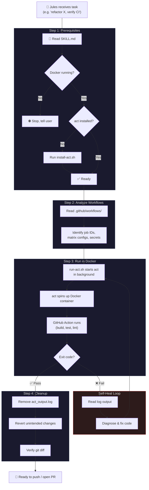

# Local Action Verification

An Agent Skill that verifies code changes by running GitHub Actions locally using [nektos/act](https://github.com/nektos/act), ensuring CI passes before pushing.

## What It Does

When an agent needs to verify that code changes pass CI, this skill instructs it to:

1. **Check prerequisites** — Docker running, `act` installed, optional Docker Hub auth
2. **Analyze workflows** — Read `.github/workflows/` to identify job IDs and matrix configs
3. **Run locally** — Execute the relevant CI job inside a Docker container via `act`
4. **Self-heal** — If tests fail, read the logs, fix the code, and re-run
5. **Clean up** — Remove log files and revert unintended changes (e.g., `package-lock.json`)

## Example Prompts

```text
Refactor lib/utils.js to use modern ES6+ syntax and verify the changes pass CI locally.
```

```text
Before opening a PR, run the test suite locally to make sure nothing is broken.
```

## How It Works

The agent reads the instructions each time it needs CI verification. No files are copied to the target repo.

The skill provides two helper scripts:
- `install-act.sh` — Installs `act` if missing (platform-aware)
- `run-act.sh` — Runs `act` in the background with log polling to avoid agent timeouts



## Prerequisites

- **Docker** — Must be installed and running
- **Internet access** — To pull runner images (~2GB for `node:20`, ~20GB for full Ubuntu)
- **act** — Installed automatically by the skill if missing

## Limitations

- `act` does [not support all GitHub Actions features](https://github.com/nektos/act#known-issues) (e.g., service containers, some caching)
- Large Docker images can be slow to pull on first run
- Jobs requiring GitHub-specific secrets need a `.secrets` file

This is not an officially supported Google product.
